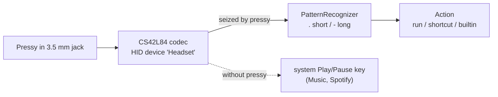

# pressy-resurrected

A small macOS daemon that brings the [Pressy](https://en.wikipedia.org/wiki/Pressy_Button) headphone-jack button (Kickstarter 2014, Android only, app long gone) back to life. Press patterns like `.`, `..`, `-` or `.-` run shell commands, Shortcuts or built-in actions (Spotify / Music / media keys, mute, volume).

Tested on a MacBook Pro M5 (Mac17,2), macOS 27.0.1.

## How it works

The Pressy is a headset button: when pressed it pulls the mic line of the 4-pole jack to ground. On Apple silicon Macs the audio codec (Cirrus CS42L84, Apple's "Mikey" inline-remote decoder) shows up as a built-in HID device called `Headset` (transport `Audio`, consumer page), and a press arrives as usage `0x0C/0xCD` (Play/Pause), value 1 then 0.



- pressy opens that device **exclusively** (`kIOHIDOptionsTypeSeizeDevice`). macOS then no longer turns the press into the system Play/Pause key, so the jack stops toggling Music or Spotify on its own. Your keyboard's media keys are not affected.
- Because the Pressy looks like a headset, macOS switches the output to "External Headphones" and the input to "External Microphone" when it is plugged in. Both are silent. pressy switches them back to the devices used before (`restoreAudioRoute`).

## Install

Needs the Xcode Command Line Tools (`xcode-select --install`), Swift 6.

```bash
make install        # runs the tests, builds, installs ~/.local/bin/pressy, loads the LaunchAgent
make logs           # tail -f ~/Library/Logs/pressy.log
make uninstall      # removes binary and LaunchAgent, keeps config and log
```

`make install` creates `~/.config/pressy/config.json` from [config.example.json](config.example.json) if it does not exist yet. After editing the config:

```bash
pressy reload       # validates the config, then restarts the LaunchAgent
```

## Find your patterns

```bash
launchctl bootout gui/$(id -u)/io.schaedler.pressy   # watch needs the button, so stop the agent
pressy watch                                         # prints every press and the recognised pattern
launchctl bootstrap gui/$(id -u) ~/Library/LaunchAgents/io.schaedler.pressy.plist
```

## Config

`~/.config/pressy/config.json` (or `$PRESSY_CONFIG`). Unknown keys are errors, so typos fail loudly.

```json
{
  "longPressMs": 500,
  "sequenceGapMs": 400,
  "restoreAudioRoute": true,
  "actionTimeoutSeconds": 30,
  "patterns": {
    ".":   { "builtin": "spotify.playpause" },
    "..":  { "shortcut": "Toggle Focus" },
    "-":   { "builtin": "input.togglemute" },
    ".-":  { "run": "open -a 'Visual Studio Code'" }
  }
}
```

| Key | Default | Meaning |
|---|---|---|
| `longPressMs` | 500 | a press held this long is `-`, shorter is `.` (100-5000) |
| `sequenceGapMs` | 400 | silence after a release that ends the pattern (100-3000) |
| `restoreAudioRoute` | true | undo the switch to the jack's headphones/mic on plug-in |
| `actionTimeoutSeconds` | 30 | `run`, `shortcut`, `spotify.*` and `music.*` actions are killed after this (1-3600) |
| `patterns` | `{}` | pattern -> action; a pattern is 1 to 5 of `.` and `-` |

A pattern fires after `sequenceGapMs` of silence, or **immediately** when no other configured pattern starts with it. If you only map `.` and `-`, a single press fires right on release.

Each action has exactly one key:

| Action | Runs |
|---|---|
| `{"run": "<command>"}` | `/bin/zsh -lc "<command>"` with `PRESSY_PATTERN` in the environment |
| `{"shortcut": "<name>"}` | `shortcuts run "<name>"`; `pressy check` verifies the name exists |
| `{"builtin": "<name>"}` | one of the built-in actions below |

### Built-in actions (`pressy actions`)

| Name | Does |
|---|---|
| `media.playpause`, `media.next`, `media.previous` | system media keys, go to whatever is playing; needs Accessibility |
| `spotify.playpause`, `spotify.next`, `spotify.previous` | Spotify via AppleScript, only if it is running |
| `music.playpause`, `music.next`, `music.previous` | Apple Music via AppleScript, only if it is running |
| `output.togglemute` | mute/unmute the current output device |
| `output.volumeup`, `output.volumedown` | output volume one step (1/16); up also unmutes |
| `input.togglemute` | mute/unmute the current microphone, handy in calls |

## Commands

| Command | Does |
|---|---|
| `pressy run` | the daemon (what the LaunchAgent runs) |
| `pressy watch` | print presses and patterns, run nothing |
| `pressy check` | validate the config and the Shortcut names |
| `pressy reload` | `check`, then restart the LaunchAgent |
| `pressy trigger <pattern>` | run the mapped action once, exit code = result |
| `pressy actions` | list the built-in actions |

All commands take `--config PATH`. Exit codes: 0 ok, 1 action or check failed, 64 usage, 69 Headset device unavailable (or held by another pressy), 78 config error.

## Permissions

| Used for | Permission | When |
|---|---|---|
| `media.*` | Accessibility | prompted when the daemon starts with such a mapping |
| `spotify.*`, `music.*` | Automation (control Spotify / Music) | prompted on first use |
| button | Input Monitoring | may be prompted on first start; allow `pressy` |

The binary is ad-hoc signed, so macOS ties these grants to the exact build. After a rebuild, remove the old entries and allow again: `tccutil reset All io.schaedler.pressy`.

## Logs

One line per event in `~/Library/Logs/pressy.log`:

```
2026-10-17T12:27:17.816+0200 INFO audio route restored role=output from="External Headphones" to="MacBook Pro Speakers"
2026-10-17T12:30:02.114+0200 INFO press ms=182
2026-10-17T12:30:02.517+0200 INFO pattern pattern=. action="builtin spotify.playpause"
2026-10-17T12:30:02.601+0200 INFO action done pattern=. action="builtin spotify.playpause" ms=84 output=""
```

Failed actions log `ERROR action failed` with the exit code and the last 300 bytes of output. Delivery is at-most-once: presses while the daemon is down are lost, failed actions are not retried.

## Limitations

- macOS cannot tell a Pressy from a wired headset. While pressy runs, a real headset's center button is taken by pressy too, and `restoreAudioRoute` also redirects real headphones away. Set `"restoreAudioRoute": false` or stop the agent while you use wired headphones.
- Only the built-in jack decoder (`Transport=Audio`, `Product=Headset`) is supported, not USB-C headset adapters.

## Development

```bash
make test           # swift test; unit tests for the pattern recognizer, config parser and audio-route policy
make build
```

`PressyCore` holds the pure logic (patterns, config, route policy), `pressy` the IOKit / CoreAudio / process glue.
