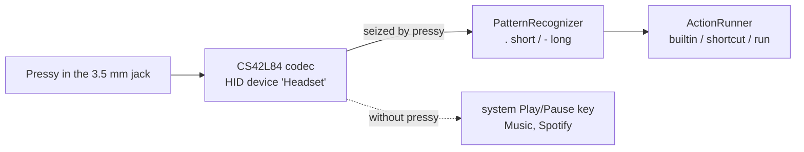
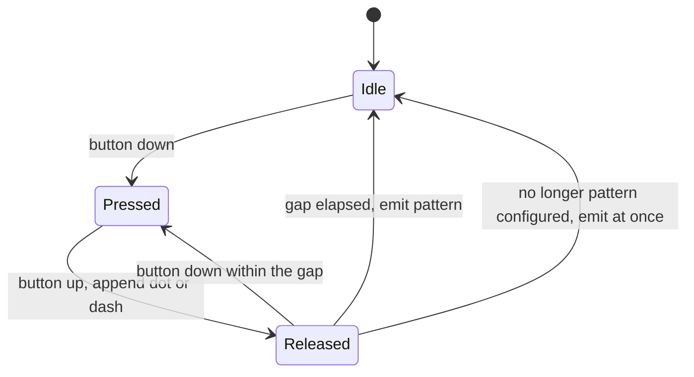
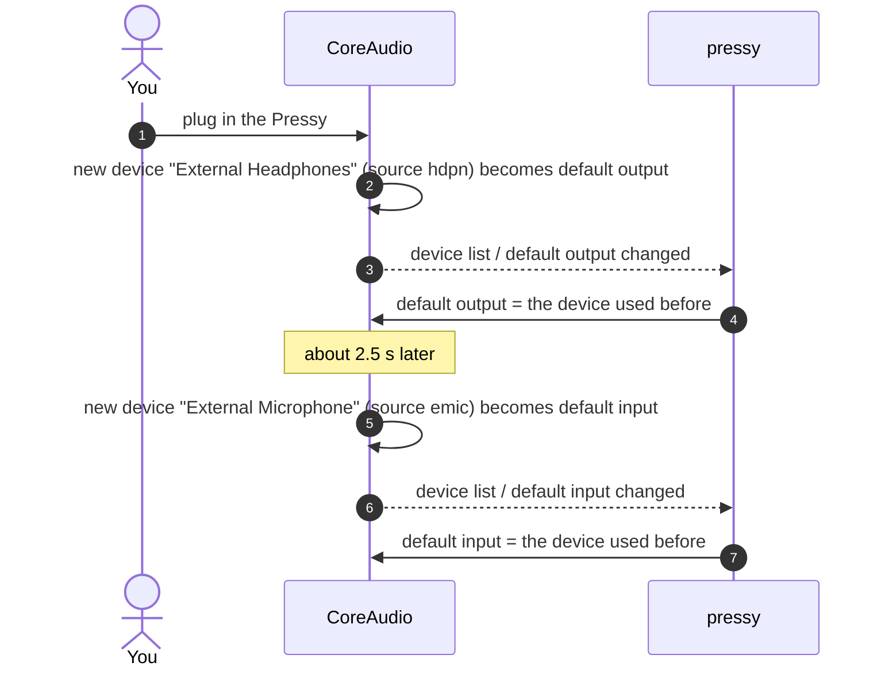
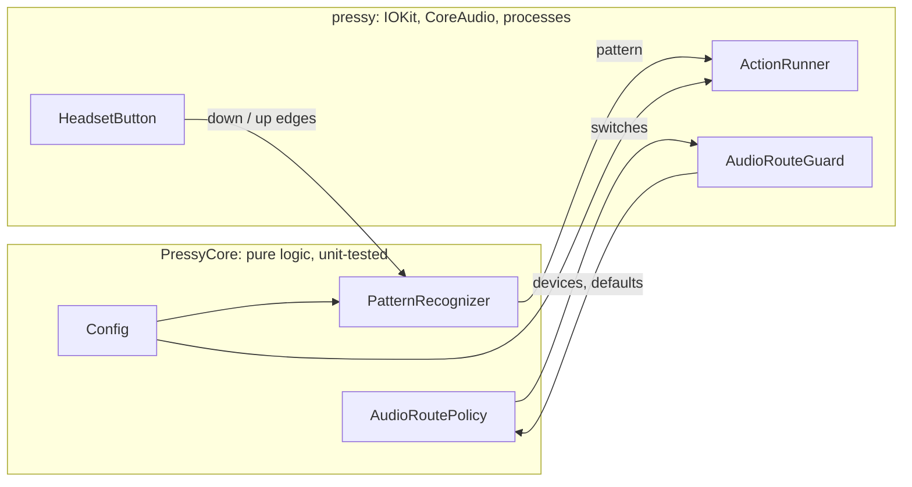

# pressy-resurrected

**Your old Pressy button, alive again - on a Mac.**

[Pressy](https://en.wikipedia.org/wiki/Pressy_Button) was a 2014 Kickstarter gadget: a tiny button that sits in the headphone jack and triggers actions on Android phones. The company and its app are long gone. `pressy` is a small macOS daemon that makes the button useful again: press patterns like `.`, `..`, `-` or `.-` run shell commands, Apple Shortcuts or built-in actions such as Spotify play/pause, next track or microphone mute.

Tested on a MacBook Pro M5 (Mac17,2) with macOS 27.0.1. It should work on any Apple silicon Mac whose 3.5 mm jack takes headsets.

- [Quick start](#quick-start)
- [Using it](#using-it): [patterns](#press-patterns), [config](#configure), [actions](#actions), [commands](#commands), [permissions](#permissions), [logs](#logs), [troubleshooting](#troubleshooting-dont-panic)
- [How it works](#how-it-works)
- [Development](#development)

## Quick start

```bash
xcode-select --install          # once, if the Command Line Tools are missing
git clone ssh://git@git.sudo.li:222/lab/pressy-resurrected.git
cd pressy-resurrected
make install                    # tests, builds, installs ~/.local/bin/pressy and the LaunchAgent li.sudo.pressy
```

1. Plug the Pressy into the headphone jack.
2. macOS asks whether `pressy` may use **Input Monitoring**: allow it. pressy restarts itself a moment later.
3. Press:

| Press | Pattern | Default action |
|---|---|---|
| once | `.` | Spotify play/pause |
| twice | `..` | Spotify next track |
| three times | `...` | Spotify previous track |
| hold (half a second) | `-` | mute / unmute the microphone |
| short, then hold | `.-` | your Mac says "Pressy is alive" |

The first Spotify press asks whether `pressy` may control Spotify: allow it.

Your sound stays on the speakers and your mic stays the built-in one, even though macOS thinks you just plugged in a headset.

## Using it

### Press patterns

A pattern is a sequence of up to 5 presses: `.` is a short press, `-` a long one (held at least `longPressMs`, default 500 ms).

| Pattern | You do |
|---|---|
| `.` | click |
| `..` | double-click |
| `-` | press and hold |
| `.-` | click, then press and hold |
| `-.` | hold, then click |
| `--` | hold twice |

A pattern fires after `sequenceGapMs` (400 ms) without a new press. When no configured pattern can still follow, it fires **at once** on release. With only `.` and `-` mapped, every press reacts instantly. Mapping `..` as well makes `.` wait those 400 ms to see whether a second click follows.

To see what your fingers actually produce, stop the agent and watch:

```bash
launchctl bootout gui/$(id -u)/li.sudo.pressy
pressy watch                    # prints every press with its duration and the recognised pattern; Ctrl-C to stop
launchctl bootstrap gui/$(id -u) ~/Library/LaunchAgents/li.sudo.pressy.plist
```

### Configure

The config lives in `~/.config/pressy/config.json` (or wherever `$PRESSY_CONFIG` points). `make install` creates it from [config.example.json](config.example.json). After editing:

```bash
pressy reload                   # validates the config first, then restarts the agent
```

A broken config is rejected with the exact spot (`patterns[".."]: unknown key "shorcut"`), and the running daemon keeps going.

```json
{
  "longPressMs": 500,
  "sequenceGapMs": 400,
  "restoreAudioRoute": true,
  "actionTimeoutSeconds": 30,
  "patterns": {
    ".":   { "builtin": "spotify.playpause" },
    "..":  { "shortcut": "Toggle Focus" },
    "-":   { "builtin": "input.togglemute" },
    ".-":  { "run": "open -a 'Visual Studio Code'" },
    "--":  { "run": "~/bin/pressy-hook.sh" }
  }
}
```

| Key | Default | Meaning |
|---|---|---|
| `longPressMs` | 500 | a press held this long is `-`, shorter is `.` (100-5000) |
| `sequenceGapMs` | 400 | silence after a release that ends the pattern (100-3000) |
| `restoreAudioRoute` | `true` | undo the switch to the jack's "headphones" and "microphone" when the Pressy is plugged in |
| `actionTimeoutSeconds` | 30 | `run`, `shortcut`, `spotify.*` and `music.*` actions are stopped after this (1-3600) |
| `patterns` | `{}` | pattern -> action |

Unknown keys are errors, so typos fail loudly instead of being silently ignored.

### Actions

Each action has exactly one of these keys:

| Action | Does |
|---|---|
| `{"builtin": "<name>"}` | one of the built-in actions below |
| `{"shortcut": "<name>"}` | runs an Apple Shortcut by its exact name (`shortcuts run`); `pressy check` verifies the name exists |
| `{"run": "<command>"}` | runs the command in a zsh login shell (`/bin/zsh -lc`), so your `PATH` from `.zprofile` applies; `PRESSY_PATTERN` holds the pattern |

**Built-in actions** (`pressy actions` lists them):

| Name | Does |
|---|---|
| `spotify.playpause`, `spotify.next`, `spotify.previous` | controls Spotify, only if it is running (never launches it) |
| `music.playpause`, `music.next`, `music.previous` | controls Apple Music, only if it is running |
| `media.playpause`, `media.next`, `media.previous` | sends the system media keys, which go to whatever is playing (browser, Podcasts, ...) |
| `output.togglemute` | mutes / unmutes the current output device |
| `output.volumeup`, `output.volumedown` | output volume one step (1/16); up also unmutes |
| `input.togglemute` | mutes / unmutes the current microphone, a hardware mute button for calls |

**Ideas for `run`:**

```json
".-":  { "run": "osascript -e 'display notification \"Pressy pressed\" with title \"pressy\"'" },
"-.":  { "run": "pmset displaysleepnow" },
"---": { "run": "curl -fsS -m 5 -X POST http://homeassistant.local:8123/api/webhook/pressy" },
"--":  { "run": "~/bin/pressy-hook.sh" }
```

One script for everything, switching on the pattern:

```bash
#!/bin/zsh
# ~/bin/pressy-hook.sh - called by pressy, PRESSY_PATTERN is ".", "..", "-", ...
case "$PRESSY_PATTERN" in
  --) open -a Terminal ;;
  *)  say "pattern $PRESSY_PATTERN" ;;
esac
```

### Commands

| Command | Does |
|---|---|
| `pressy run` | the daemon itself (what the LaunchAgent starts) |
| `pressy watch` | prints presses and patterns, runs nothing |
| `pressy check` | validates the config and the Shortcut names |
| `pressy reload` | `check`, then restarts the LaunchAgent |
| `pressy trigger <pattern>` | runs the mapped action once without pressing; exit code = result |
| `pressy actions` | lists the built-in actions |

All commands take `--config PATH`. Exit codes: `0` ok, `1` action or check failed, `64` usage, `69` Headset device missing or held by another pressy, `75` restart requested (new permission), `78` config error.

`make install` / `make uninstall` (keeps config and log) / `make logs` (`tail -f` on the log).

### Permissions

macOS asks once per permission. The entries are called `pressy` in System Settings > Privacy & Security.

| Permission | Needed for | When it is asked |
|---|---|---|
| Input Monitoring | the button itself | on the first start; pressy restarts itself once you allow it |
| Automation (Spotify, Music) | `spotify.*`, `music.*` | on the first such press |
| Accessibility | `media.*` | at start, when the config uses a `media.*` action |

The binary is ad-hoc signed, so macOS ties these grants to the exact build. After rebuilding, clear the old entries and allow again:

```bash
tccutil reset All li.sudo.pressy && pressy reload
```

### Logs

`~/Library/Logs/pressy.log`, one line per event:

```
2026-10-17T12:27:17.816+0200 INFO audio route restored role=output from="External Headphones" to="MacBook Pro Speakers"
2026-10-17T12:30:02.114+0200 INFO press ms=182
2026-10-17T12:30:02.517+0200 INFO pattern pattern=. action="builtin spotify.playpause"
2026-10-17T12:30:02.601+0200 INFO action done pattern=. action="builtin spotify.playpause" ms=84 output=""
2026-10-17T12:31:10.020+0200 ERROR action failed pattern=-- action="run \"~/bin/pressy-hook.sh\"" ms=12 exit=127 output="zsh:1: no such file or directory: /Users/you/bin/pressy-hook.sh"
```

### Troubleshooting (Don't Panic)

| Symptom | Fix |
|---|---|
| Presses do nothing, log says `input monitoring not granted` | allow `pressy` under Privacy & Security > Input Monitoring |
| Worked before a rebuild, now nothing | `tccutil reset All li.sudo.pressy && pressy reload`, then allow again |
| Music opens or Spotify toggles on its own when you press | pressy is not running: `launchctl print gui/$(id -u)/li.sudo.pressy`, check the log |
| `held by another process` | `pressy watch` while the agent runs; stop the agent first (see [Press patterns](#press-patterns)) |
| Spotify does not react | Spotify must be running; check Privacy & Security > Automation > pressy > Spotify |
| No sound after plugging in the Pressy | look for `audio route restored` in the log; `restoreAudioRoute` must be `true` |
| Real wired headphones go silent | `restoreAudioRoute` moves sound away from them too, see [Limitations](#limitations) |

### Limitations

- macOS cannot tell a Pressy from a wired headset. While pressy runs, the center button of a real headset belongs to pressy too, and `restoreAudioRoute` moves sound away from real headphones. Set `"restoreAudioRoute": false` or stop the agent while you use wired headphones.
- Only the built-in jack is supported, not USB-C headset adapters.
- Delivery is at-most-once: presses while the daemon is down are lost, failed actions are logged and not retried.

## How it works

### The button

The Pressy is a passive button on a 4-pole (TRRS) plug. Plugged in, it looks like a headset microphone to the jack. Pressed, it shorts the mic line to ground, exactly what the center button of any wired headset does (the [Android headset jack spec](https://source.android.com/devices/accessories/headset/jack-headset-spec) detects that button at 70 Ω or less).

### What macOS sees

On Apple silicon the jack is driven by a Cirrus Logic CS42L84 codec. Its inline-remote decoder (Apple's name: "Mikey") is a built-in HID device:

```
$ hidutil list | grep Headset
0x0  0x0  0x0  12  1  0x100000c5d  Audio  AppleCS42L84Mikey  Headset  (null)  1
```

A press is HID usage `0x0C/0xCD` (consumer page, Play/Pause), value `1` on press and `0` on release. Measured with the Pressy: short presses last 106-255 ms, a double-click has about 150 ms between presses, and a long press simply holds `1` with no auto-repeat. Left alone, macOS turns this into the system Play/Pause key, which goes to the app that is playing or starts Music.

### Taking the button



pressy opens the Headset device with `kIOHIDOptionsTypeSeizeDevice`, which means exclusive access. The press never reaches the window server, so the jack stops toggling music on its own, and the media keys on your keyboard keep working. No event tap and no Accessibility permission are needed for this. Input Monitoring is: without it the device opens without error but delivers no values. Only one process can seize the device, so a second pressy fails with `kIOReturnExclusiveAccess` (`0xE00002C5`).

### Recognising patterns



On release the press duration decides between `.` and `-`. If a configured pattern starts with the sequence so far, pressy waits `sequenceGapMs` for another press; otherwise it emits right away. Repeated edges in the same direction are ignored, so duplicate HID reports cannot create phantom presses. The timing comes from the HID event timestamps, not from when pressy gets around to handling them.

### Keeping your audio where it was

Because the Pressy looks like a headset, macOS creates two new audio devices when it is plugged in and makes them the defaults. Both are silent.



pressy only undoes a switch to a jack device that appeared within the last 5 seconds. If you pick "External Headphones" by hand later, it stays. When the Pressy is already plugged in at start, pressy falls back to the built-in speakers (`ispk`) and microphone (`imic`). Devices are recognised by their data source code, not by their localised names.

### Running actions

- `run`, `shortcut`, `spotify.*`, `music.*` start a child process (`zsh -lc`, `shortcuts run`, `osascript`) without blocking the button. Each one has a timeout; exit code, duration and the last 300 bytes of output go to the log.
- `output.*` and `input.togglemute` talk to CoreAudio directly.
- `media.*` posts system media-key events. The cleaner MediaRemote API no longer answers third-party processes on current macOS.

### Code layout



| Path | Contents |
|---|---|
| `Sources/PressyCore/` | `PatternRecognizer`, `Config` (strict JSON), `AudioRoutePolicy`, `BuiltinAction` |
| `Sources/pressy/` | `HeadsetButton` (IOKit HID), `AudioHardware` + `AudioRouteGuard` (CoreAudio), `ActionRunner`, `Log`, CLI in `main.swift` |
| `Support/Info.plist` | linked into the binary (`-sectcreate`), gives it the bundle id `li.sudo.pressy` for the privacy settings |
| `scripts/` | install / uninstall; the LaunchAgent plist is generated by `install.sh` |
| `Tests/PressyCoreTests/` | swift-testing suites for the three core types |

## Development

```bash
make test       # swift test; with only the Command Line Tools it adds the swift-testing plugin path
make build      # release build in .build/release/pressy
.build/release/pressy trigger .. --config config.example.json   # try an action without the button
```

Swift 6 language mode, no dependencies. So long, and thanks for all the clicks.
