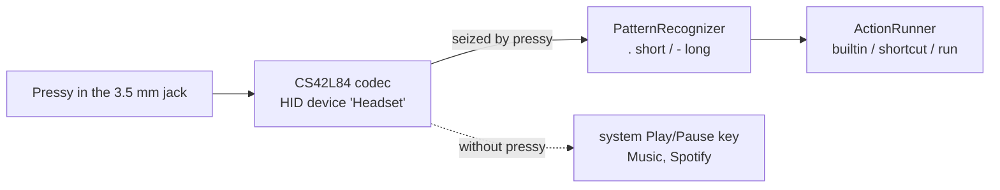
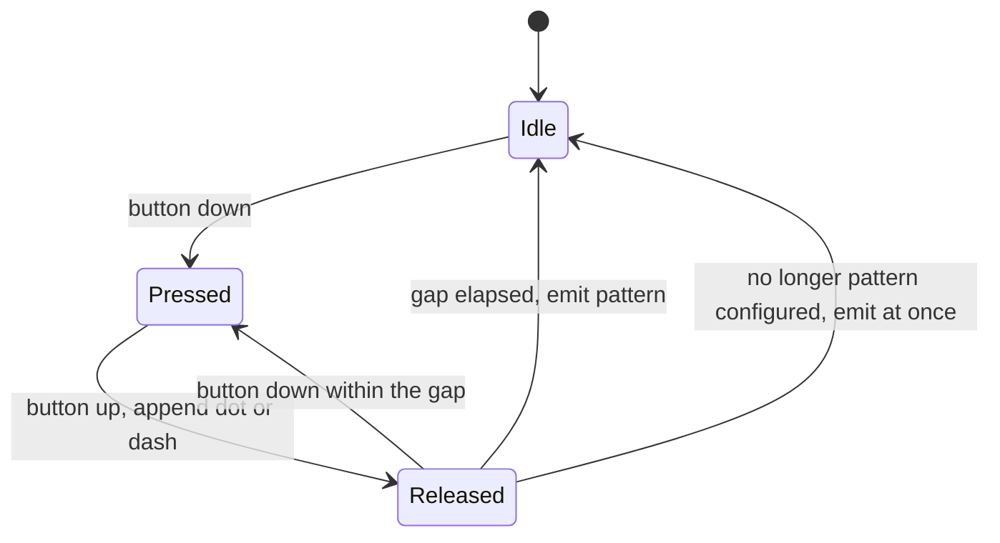
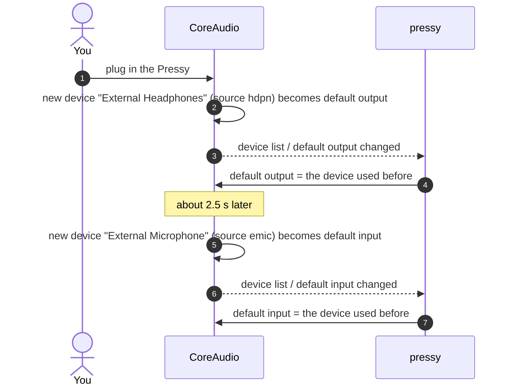
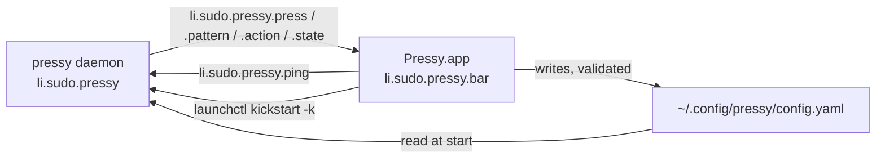
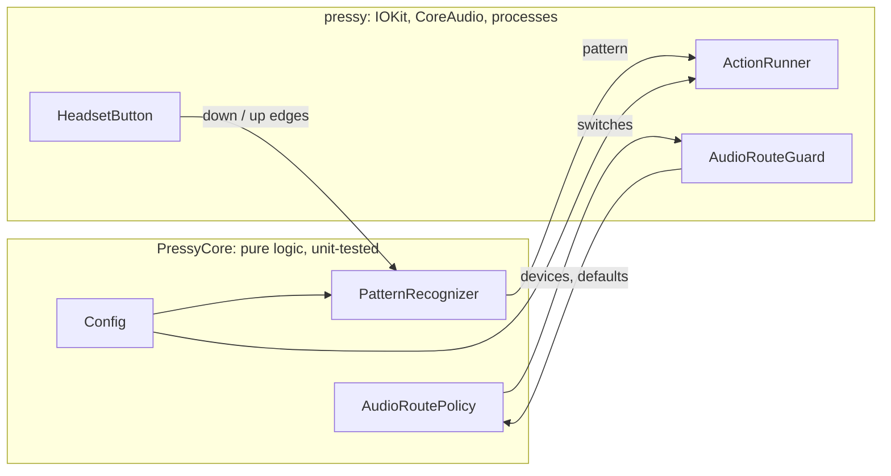

# pressy-resurrected

**Your old Pressy button, alive again - on a Mac.**

[](https://github.com/gufertum/pressy-resurrected/releases/latest)

[](LICENSE)

[Pressy](https://en.wikipedia.org/wiki/Pressy_Button) was a 2014 Kickstarter gadget: a tiny button that sits in the headphone jack and triggers actions on Android phones. The company and its app are long gone. `pressy` is a small macOS daemon that makes the button useful again: press patterns like `.`, `..`, `-` or `.-` run shell commands, Apple Shortcuts or built-in actions such as Spotify play/pause, next track or microphone mute.

Tested on a MacBook Pro M5 (Mac17,2) with macOS 27.0.1. It should work on any Apple silicon Mac whose 3.5 mm jack takes headsets.

- [Quick start](#quick-start)
- [Using it](#using-it): [menu bar app](#menu-bar-app), [patterns](#press-patterns), [config](#configure), [actions](#actions), [commands](#commands), [permissions](#permissions), [logs](#logs), [troubleshooting](#troubleshooting-dont-panic)
- [How it works](#how-it-works)
- [Development](#development)

## Quick start

```bash
curl -fsSL https://raw.githubusercontent.com/gufertum/pressy-resurrected/main/get-pressy.sh | bash
```

That downloads the latest [release](https://github.com/gufertum/pressy-resurrected/releases/latest), checks its sha256, and installs `~/.local/bin/pressy`, `~/Applications/Pressy.app` and their LaunchAgents. Your config is left alone if you have one. Rather read before you pipe into a shell? Same thing in three steps:

```bash
curl -fsSLO https://raw.githubusercontent.com/gufertum/pressy-resurrected/main/get-pressy.sh
less get-pressy.sh
bash get-pressy.sh
```

<details>
<summary>Other ways to install</summary>

**Release zip by hand.** Download `pressy-<version>-macos-arm64.zip` from the releases page, compare it with the `.sha256` file, unpack it, then:

```bash
xattr -dr com.apple.quarantine pressy-*/   # a browser download is quarantined, see below
pressy-*/scripts/install.sh
```

**From source** (needs the Command Line Tools: `xcode-select --install`):

```bash
git clone https://github.com/gufertum/pressy-resurrected.git
cd pressy-resurrected
make cert        # once: local code-signing certificate, keeps permissions across rebuilds
make install     # tests, builds, signs, installs
```

**About signing.** The releases are signed with the maintainer's self-signed certificate. They are not notarized, because that needs a paid Apple Developer ID. `curl` does not mark downloads as quarantined, so Gatekeeper does not get involved. Files downloaded with a browser are marked; `xattr` above removes the mark. Every release carries the same signature, so macOS keeps your permissions across updates. To update, run the one-liner again.

</details>

1. Plug the Pressy into the headphone jack.
2. Allow **Input Monitoring** for `pressy` when macOS asks; without it the button stays silent. Step by step: [Permissions](#permissions).
3. Press:

| Press | Pattern | Default action |
|---|---|---|
| once | `.` | Spotify play/pause |
| twice | `..` | Spotify next track |
| three times | `...` | Spotify previous track |
| hold (half a second) | `-` | a "Tink", then mute / unmute the microphone |
| short, then hold | `.-` | Raycast confetti (if you have Raycast) |
| hold, then short | `-.` | your Mac says "Pressy is alive" |

The first Spotify press asks whether `pressy` may control Spotify: allow it.

Your sound stays on the speakers and your mic stays the built-in one, even though macOS thinks you just plugged in a headset.

## Using it

### Menu bar app

`Pressy.app` puts a ◎ in the menu bar; it flashes on every press. Click it to see:

- whether the daemon runs, has Input Monitoring and whether the Pressy is plugged in
- the live activity: each press with its duration, the recognised pattern and every action's result
- the current configuration

**Edit…** (<kbd>⌘</kbd><kbd>,</kbd>) opens the editor: a page per pattern and one for the general settings. For each action, pick its type and then the value: built-ins from a grouped list, Shortcuts from your Shortcuts library, a script or sound file through a file picker, key combinations with **Record** (click, then press the keys), Raycast deeplinks from examples. **Test now** runs a pattern's actions once without saving. **Save & apply** validates everything, writes the config file (in its format, YAML or JSON) and restarts the daemon. The editor rewrites the file in its own tidy format, so comments you added by hand are lost.

The app is optional: it only edits the config file and listens to the daemon. It starts at login (LaunchAgent `li.sudo.pressy.bar`); **Quit Pressy menu** in its ⋯ menu stops it until the next login.

### Press patterns

A pattern is a sequence of up to 5 presses: `.` is a short press, `-` a long one (held at least `longPressMs`, default 500 ms).

| Pattern | You do |
|---|---|
| `.` | click |
| `..` | double-click |
| `-` | press and hold |
| `.-` | click, then press and hold |
| `-.` | hold, then click |
| `--` | hold twice |

A pattern fires after `sequenceGapMs` (400 ms) without a new press. When no configured pattern can still follow, it fires **at once** on release. With only `.` and `-` mapped, every press reacts instantly. Mapping `..` as well makes `.` wait those 400 ms to see whether a second click follows.

To see what your fingers actually produce, stop the agent and watch:

```bash
launchctl bootout gui/$(id -u)/li.sudo.pressy
pressy watch                    # prints every press with its duration and the recognised pattern; Ctrl-C to stop
launchctl bootstrap gui/$(id -u) ~/Library/LaunchAgents/li.sudo.pressy.plist
```

### Configure

The config lives in `~/.config/pressy/config.yaml` (or wherever `$PRESSY_CONFIG` points). `make install` creates it from [config.example.yaml](config.example.yaml). After editing:

```bash
pressy reload                   # validates the config first, then restarts the agent
```

A broken config is rejected with the exact spot (`patterns[".."]: unknown key "shorcut"`), and the running daemon keeps going.

```yaml
longPressMs: 500
sequenceGapMs: 400
restoreAudioRoute: true
actionTimeoutSeconds: 30

patterns:
  ".":   { builtin: spotify.playpause }
  "..":  { shortcut: Toggle Focus }
  "-":   { builtin: input.togglemute }
  ".-":  { run: "open -a 'Visual Studio Code'" }
  "--":  { script: ~/bin/pressy-hook.sh }
```

**Always quote the patterns.** A bare `-` starts a YAML list, and pressy then tells you so. Values with `:`, `#` or quotes in them need quotes too; the menu bar editor writes every value quoted.

**Prefer JSON?** Name the file `config.json` (or point `$PRESSY_CONFIG` at any `.json` file); same keys, same validation:

```json
{ "longPressMs": 500, "patterns": { ".": { "builtin": "spotify.playpause" }, "-": [{ "sound": "Tink" }, { "builtin": "input.togglemute" }] } }
```

pressy uses the first existing of `config.yaml`, `config.yml`, `config.json`. `pressy convert config.json config.yaml` converts between the formats; `make install` does that once for an old `config.json` (kept as `config.json.bak`).

| Key | Default | Meaning |
|---|---|---|
| `longPressMs` | 500 | a press held this long is `-`, shorter is `.` (100-5000) |
| `sequenceGapMs` | 400 | silence after a release that ends the pattern (100-3000) |
| `restoreAudioRoute` | `true` | undo the switch to the jack's "headphones" and "microphone" when the Pressy is plugged in |
| `actionTimeoutSeconds` | 30 | child processes (`run`, `script`, `shortcut`, `raycast`, AppleScript built-ins) are stopped after this (1-3600) |
| `patterns` | `{}` | pattern -> action, or a list of actions |

Unknown keys are errors, so typos fail loudly instead of being silently ignored.

### Actions

Each action has exactly one of these keys:

| Action | Does |
|---|---|
| `builtin: <name>` | one of the built-in actions below |
| `shortcut: <name>` | runs an Apple Shortcut by its exact name (`shortcuts run`) |
| `script: <path>` | runs an executable file (`~` allowed, needs `chmod +x`) |
| `run: <command>` | runs the command in a zsh login shell (`/bin/zsh -lc`), so your `PATH` from `.zprofile` applies |
| `keys: <combo>` | presses a key combination, e.g. `cmd+shift+4`, `ctrl+cmd+q`, `opt+space`, `f5` (needs Accessibility) |
| `raycast: <deeplink>` | opens a Raycast deeplink: `confetti`, `extensions/raycast/clipboard-history/clipboard-history`, any `raycast://...` |
| `sound: <name or file>` | plays a system sound (`Glass`, `Ping`, `Submarine`, ... from `/System/Library/Sounds`) or any audio file |

`script` and `run` get the pattern in `PRESSY_PATTERN`. `pressy check` verifies that Shortcuts, scripts and sounds exist and that an app handles `raycast://`.

**Several actions per pattern.** Use a list; the actions run one after another. A sound only starts, so it never delays what follows:

```yaml
  "-":
    - sound: Tink
    - builtin: input.togglemute
  "--":
    - keys: cmd+c
    - keys: cmd+tab
    - keys: cmd+v
```

**Key combinations.** Modifiers `cmd`, `shift`, `ctrl`, `opt` (or `alt`), `fn`, joined with `+`. The last part is a character (`a`, `4`, `/`, written `plus` for `+`) or a named key: `return`, `tab`, `space`, `escape`, `delete`, `forwarddelete`, `left`, `right`, `up`, `down`, `home`, `end`, `pageup`, `pagedown`, `f1` to `f20`. Characters follow your current keyboard layout, so `cmd+z` is undo on QWERTZ as well. Any macOS or app shortcut works this way.

**Built-in actions** (`pressy actions` lists them):

| Name | Does |
|---|---|
| `spotify.playpause`, `spotify.next`, `spotify.previous` | controls Spotify, only if it is running (never launches it) |
| `music.playpause`, `music.next`, `music.previous` | controls Apple Music, only if it is running |
| `media.playpause`, `media.next`, `media.previous` | sends the system media keys, which go to whatever is playing (browser, Podcasts, ...) |
| `output.togglemute` | mutes / unmutes the current output device |
| `output.volumeup`, `output.volumedown` | output volume one step (1/16); up also unmutes |
| `input.togglemute` | mutes / unmutes the current microphone, a hardware mute button for calls |
| `appearance.toggle`, `appearance.dark`, `appearance.light` | dark / light mode (asks once to control System Events) |
| `display.sleep` | turns the displays off; locks when a password is required after sleep |
| `system.sleep` | puts the Mac to sleep |
| `system.lock` | locks the screen (⌃⌘Q) |
| `screensaver.start` | starts the screen saver |
| `screenshot.tool` | opens the screenshot tool (⇧⌘5) |
| `missioncontrol` | shows Mission Control |
| `caffeinate.toggle` | keeps the Mac awake until pressed again (or pressy stops) |
| `time.say` | speaks the current time |

Focus / Do Not Disturb and Wi-Fi have no stable command-line interface; build a Shortcut for them and use `shortcut`. Adding a built-in yourself: one `case` in [BuiltinAction.swift](Sources/PressyCore/BuiltinAction.swift) and one line in its `definition` table (a process, an AppleScript or a key combination).

**Ideas for `run`:**

```yaml
  ".-":  { run: "osascript -e 'display notification \"Pressy pressed\" with title \"pressy\"'" }
  "---": { run: "curl -fsS -m 5 -X POST http://homeassistant.local:8123/api/webhook/pressy" }
  "--":  { script: ~/bin/pressy-hook.sh }
```

One script for everything, switching on the pattern:

```bash
#!/bin/zsh
# ~/bin/pressy-hook.sh - called by pressy, PRESSY_PATTERN is ".", "..", "-", ...
case "$PRESSY_PATTERN" in
  --) open -a Terminal ;;
  *)  say "pattern $PRESSY_PATTERN" ;;
esac
```

### Commands

| Command | Does |
|---|---|
| `pressy run` | the daemon itself (what the LaunchAgent starts) |
| `pressy watch` | prints presses and patterns, runs nothing |
| `pressy check` | validates the config and the Shortcut names |
| `pressy reload` | `check`, then restarts the LaunchAgent |
| `pressy trigger <pattern>` | runs the mapped action once without pressing; exit code = result |
| `pressy actions` | lists the built-in actions |
| `pressy convert <in> <out>` | rewrites a config in the format of `<out>`'s extension |

All commands take `--config PATH`. Exit codes: `0` ok, `1` action or check failed, `64` usage, `69` Headset device missing or held by another pressy, `75` restart requested (new permission), `78` config error.

`make install` / `make uninstall` (keeps config, logs and certificate) / `make logs` (`tail -f` on the log) / `make cert`.

Remove everything, including the certificate and the privacy entries:

```bash
make uninstall && rm -rf ~/.config/pressy ~/Library/Logs/pressy*.log
security delete-identity -c "pressy local signing"   # only if you ran make cert
```

Installed with the one-liner, without a checkout:

```bash
curl -fsSL https://raw.githubusercontent.com/gufertum/pressy-resurrected/main/scripts/uninstall.sh | bash
```

Then remove **pressy** with **−** under System Settings > Privacy & Security > Input Monitoring (and Accessibility, if you used `media.*`).

### Permissions

macOS asks once per permission. All entries are called `pressy` and live in **System Settings > Privacy & Security**.

| Permission | Needed for | When it is asked |
|---|---|---|
| Input Monitoring | the button itself, always | on the first start |
| Automation (Spotify, Music, System Events) | `spotify.*`, `music.*`, `appearance.*` | on the first such press |
| Accessibility | `keys` and `media.*` | at start, when the config uses one of them |

**Input Monitoring** (required). pressy can hold the button without it, but macOS never delivers a single press.

1. On the first start macOS shows *"pressy" would like to receive keystrokes from any application*. Click **Open System Settings**.
2. Under **Input Monitoring**, switch **pressy** on. If it is not listed, click **+**, press <kbd>⌘</kbd><kbd>⇧</kbd><kbd>G</kbd>, enter `~/.local/bin/pressy`, add it and switch it on.
3. Presses work right away. Within about a minute pressy also notices the grant and restarts itself, so its state and log are clean:

   ```
   INFO input monitoring granted, restarting exit=75
   INFO start version=0.1.0 ... input_monitoring=granted
   ```

   Impatient? `pressy reload` does the same at once.

Check the current state any time: `grep input_monitoring ~/Library/Logs/pressy.log | tail -1`.

**Automation** (Spotify, Music). The first `spotify.*` press shows *"pressy" wants access to control "Spotify"*: click **Allow**. Clicked Don't Allow by accident? Privacy & Security > Automation > pressy > Spotify, switch it on.

**Accessibility** (`keys`, `media.*`). Switch **pressy** on under Privacy & Security > Accessibility, then `pressy reload`.

**Updates and the signing certificate.** macOS ties every grant to the code signature of the binary.

- With the local certificate (`make cert`, once) every build is signed by the same identity, so the grants survive `make install`.
- Without it the build is signed ad-hoc and each build counts as a new app. The old switch stays on in System Settings but no longer applies: the log says `input_monitoring=denied` and macOS does not ask again.

To fix a stale switch (also needed once when moving from ad-hoc to the certificate):

1. System Settings > Privacy & Security > **Input Monitoring**: select **pressy**, click **−**.
2. Click **+**, press <kbd>⌘</kbd><kbd>⇧</kbd><kbd>G</kbd>, enter `~/.local/bin/pressy`, click **Open** and switch it on.
3. Presses work right away; pressy restarts itself within about a minute.

`tccutil reset` cannot do this for pressy: it only knows apps registered with Launch Services, and pressy is a bare binary.

`make cert` runs [scripts/make-signing-cert.sh](scripts/make-signing-cert.sh). It creates the self-signed identity "pressy local signing" in your login keychain (valid 10 years). The certificate is not added to any trust settings, and only `codesign` may use its key.

### Logs

`~/Library/Logs/pressy.log`, one line per event:

```
2026-10-17T12:27:17.816+0200 INFO audio route restored role=output from="External Headphones" to="MacBook Pro Speakers"
2026-10-17T12:30:02.114+0200 INFO press ms=182
2026-10-17T12:30:02.517+0200 INFO pattern pattern=. action="builtin spotify.playpause"
2026-10-17T12:30:02.601+0200 INFO action done pattern=. action="builtin spotify.playpause" ms=84 output=""
2026-10-17T12:31:10.020+0200 ERROR action failed pattern=-- action="run \"~/bin/pressy-hook.sh\"" ms=12 exit=127 output="zsh:1: no such file or directory: /Users/you/bin/pressy-hook.sh"
```

### Troubleshooting (Don't Panic)

| Symptom | Fix |
|---|---|
| Presses do nothing, log says `input monitoring not granted` | allow `pressy` under Privacy & Security > Input Monitoring, see [Permissions](#permissions) |
| Switch for pressy is on, but presses do nothing, log says `input_monitoring=denied` | the grant belongs to an older build: remove pressy with **−** and add it again, see [Permissions](#permissions); `make cert` prevents this |
| Music opens or Spotify toggles on its own when you press | pressy is not running: `launchctl print gui/$(id -u)/li.sudo.pressy`, check the log |
| `held by another process` | `pressy watch` while the agent runs; stop the agent first (see [Press patterns](#press-patterns)) |
| Spotify does not react | Spotify must be running; check Privacy & Security > Automation > pressy > Spotify |
| No sound after plugging in the Pressy | look for `audio route restored` in the log; `restoreAudioRoute` must be `true` |
| Real wired headphones go silent | `restoreAudioRoute` moves sound away from them too, see [Limitations](#limitations) |

### Limitations

- macOS cannot tell a Pressy from a wired headset. While pressy runs, the center button of a real headset belongs to pressy too, and `restoreAudioRoute` moves sound away from real headphones. Set `"restoreAudioRoute": false` or stop the agent while you use wired headphones.
- Only the built-in jack is supported, not USB-C headset adapters.
- Delivery is at-most-once: presses while the daemon is down are lost, failed actions are logged and not retried.

## How it works

### The button

The Pressy is a passive button on a 4-pole (TRRS) plug. Plugged in, it looks like a headset microphone to the jack. Pressed, it shorts the mic line to ground, exactly what the center button of any wired headset does (the [Android headset jack spec](https://source.android.com/devices/accessories/headset/jack-headset-spec) detects that button at 70 Ω or less).

### What macOS sees

On Apple silicon the jack is driven by a Cirrus Logic CS42L84 codec. Its inline-remote decoder (Apple's name: "Mikey") is a built-in HID device:

```
$ hidutil list | grep Headset
0x0  0x0  0x0  12  1  0x100000c5d  Audio  AppleCS42L84Mikey  Headset  (null)  1
```

A press is HID usage `0x0C/0xCD` (consumer page, Play/Pause), value `1` on press and `0` on release. Measured with the Pressy: short presses last 106-255 ms, a double-click has about 150 ms between presses, and a long press simply holds `1` with no auto-repeat. Left alone, macOS turns this into the system Play/Pause key, which goes to the app that is playing or starts Music.

### Taking the button



pressy opens the Headset device with `kIOHIDOptionsTypeSeizeDevice`, which means exclusive access. The press never reaches the window server, so the jack stops toggling music on its own, and the media keys on your keyboard keep working. No event tap and no Accessibility permission are needed for this. Input Monitoring is: without it the device opens without error but delivers no values. Only one process can seize the device, so a second pressy fails with `kIOReturnExclusiveAccess` (`0xE00002C5`).

### Recognising patterns



On release the press duration decides between `.` and `-`. If a configured pattern starts with the sequence so far, pressy waits `sequenceGapMs` for another press; otherwise it emits right away. Repeated edges in the same direction are ignored, so duplicate HID reports cannot create phantom presses. The timing comes from the HID event timestamps, not from when pressy gets around to handling them.

### Keeping your audio where it was

Because the Pressy looks like a headset, macOS creates two new audio devices when it is plugged in and makes them the defaults. Both are silent.



pressy only undoes a switch to a jack device that appeared within the last 5 seconds. If you pick "External Headphones" by hand later, it stays. When the Pressy is already plugged in at start, pressy falls back to the built-in speakers (`ispk`) and microphone (`imic`). Devices are recognised by their data source code, not by their localised names.

### Running actions

- `run`, `shortcut`, `spotify.*`, `music.*` start a child process (`zsh -lc`, `shortcuts run`, `osascript`) without blocking the button. Each one has a timeout; exit code, duration and the last 300 bytes of output go to the log.
- `output.*` and `input.togglemute` talk to CoreAudio directly.
- `media.*` posts system media-key events. The cleaner MediaRemote API no longer answers third-party processes on current macOS.

### Daemon and menu bar app



They talk through distributed notifications in your login session; the names and keys are defined once in [Events.swift](Sources/PressyCore/Events.swift). Nothing is queued, so the app asks for the daemon's state with `ping` when it opens. The editor and the daemon share `PressyCore`, so the editor rejects exactly what the daemon would reject.

### Code layout



| Path | Contents |
|---|---|
| `Sources/PressyCore/` | `PatternRecognizer`, `Config` (strict YAML / JSON), `ConfigDraft` (editor model), `KeyCombo`, `BuiltinAction` (table), `AudioRoutePolicy`, `PressyEvent` (daemon -> app contract) |
| `Sources/PressyBar/` | the menu bar app (SwiftUI `MenuBarExtra`): `AppModel`, `ConfigEditor`, `ActionRow` with the key recorder |
| `Sources/pressy/` | `HeadsetButton` (IOKit HID), `AudioHardware` + `AudioRouteGuard` (CoreAudio), `ActionRunner`, `Log`, CLI in `main.swift` |
| `Support/Info.plist` | linked into the binary (`-sectcreate`), gives it the bundle id `li.sudo.pressy` for the privacy settings |
| `scripts/` | install / uninstall (the LaunchAgent plist is generated by `install.sh`), `make-signing-cert.sh` |
| `Tests/PressyCoreTests/` | swift-testing suites for the three core types |

## Development

```bash
make test       # swift test; with only the Command Line Tools it adds the swift-testing plugin path
make build      # release build in .build/release/pressy
make release    # dist/pressy-<version>-macos-arm64.zip + .sha256, signed with the local certificate
.build/release/pressy trigger .. --config config.example.yaml   # try an action without the button
```

Swift 6 language mode; one dependency, [Yams](https://github.com/jpsim/Yams) for reading YAML. Builds with the Command Line Tools alone: the Makefile adds the swift-testing plugin path, and the app uses `@Local` (a thin wrapper around `SwiftUI.State`) because `@State` is a macro in the macOS 27 SDK whose plugin ships only with Xcode. So long, and thanks for all the clicks.
